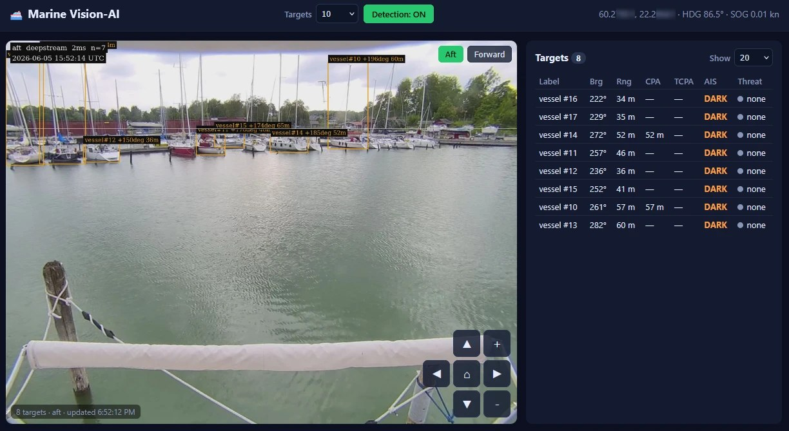

# Marine Vision-AI for Signal K

Turns your boat's cameras into a visual radar. A separate vision container
finds boats, buoys and people in the camera pictures. This plugin places
each one on the chart from your own position and heading, matches them
against AIS, and raises standard Signal K alarms:

- **Man overboard:** a person in the water is seen for several frames in a row.
- **Collision risk:** a boat's closest point of approach (CPA) and time to it
  (TCPA) fall below your limits.
- **Dark target:** a vessel in range is not sending AIS.

It also serves the **Vision-AI** webapp: annotated live video from each
camera, the target list with true bearing, range, CPA, TCPA and AIS match,
and pan/tilt/zoom control for PTZ cameras.



> **Safety.** Camera-based alarms are an aid to a proper lookout, radar and
> AIS, never a replacement. Range from a single camera is approximate, and
> man-overboard detection is a best effort. The man-overboard, collision and
> dark-target alarms are on by default; turn off any you don't want. Publishing
> targets to the chart and IMU horizon compensation are off by default.

## What you need

- **Signal K Server** with Node.js 18 or later.
- **The vision container**, running on a computer the plugin can reach,
  usually the same one. It needs one of:
  - an NVIDIA Jetson Orin (JetPack 6) or Jetson Xavier (JetPack 5): best;
  - any x86_64 or arm64 computer, which detects on its CPU at about 5 frames
    per second.
- **Two IP cameras**, forward and aft, each with an RTSP stream.

The plugin does nothing useful on its own. Without the container it shows
setup steps, and raises an alarm so you know the camera alarms are off.

## Install

1. **Install the plugin.** In the Signal K admin, open **Apps & Plugins →
   App Store**, find **Marine Vision-AI**, install it and restart the server.
2. **Enable it.** Open **Server → Plugin Config → Marine Vision-AI**, turn on
   **Enabled** and save. The defaults work for a container on the same
   computer.
3. **Start the vision container.** Open the **Vision-AI** webapp from the
   Signal K menu. While no container answers, it shows step-by-step setup for
   your hardware: which compose file to download, where to put the camera
   addresses, and how to start it. The container restarts by itself after
   every reboot, and the steps close by themselves once it answers. The same
   steps are in
   [Prebuilt images and releases](https://github.com/KEGustafsson/vision-ai/blob/main/docs/release.md).
4. **Calibrate the cameras** (horizon, mounting height, field of view,
   bearing offset) before trusting bearings and ranges: see
   [Geometry & calibration](https://github.com/KEGustafsson/vision-ai/blob/main/docs/geometry.md)
   and the
   [onboard verification runbook](https://github.com/KEGustafsson/vision-ai/blob/main/docs/onboard-verification.md).

Install the container release with the same version as the plugin. The
webapp's setup steps always do.

## Works with

The App Store recommends these companions; none is required.

| Plugin | What it adds |
|--------|--------------|
| [Freeboard-SK](https://www.npmjs.com/package/@signalk/freeboard-sk) | Draws the camera targets on the chart (needs **Publish targets to the chart** and Freeboard-SK 3.5 or later), and the collision alarms on the boat they concern |
| [Target Fusion](https://www.npmjs.com/package/signalk-target-fusion) | Merges a boat the cameras and AIS both see into one target, drawn as its AIS vessel |
| [Collision Alerts](https://www.npmjs.com/package/@signalk/collision-alerts) | Alarms on the camera targets itself; this plugin then raises no second alarm for a boat it already alarms |

## Alarms and notifications

All use standard Signal K notification paths, so any chartplotter, MFD or app
that shows Signal K notifications shows them.

| Path | State | When |
|------|-------|------|
| `notifications.mob` | emergency | A person in the water, seen for several frames in a row. Carries their position |
| `notifications.navigation.closestApproach.visionai…` | warn, then alarm | Collision risk with a boat, one alarm per boat |
| `notifications.vision.darkTarget.…` | alert | A vessel in range with no matching AIS, once per boat |
| `notifications.vision.containerDown` | alarm | The vision container does not answer: no detections, video or camera alarms |
| `notifications.vision.containerDegraded` | warn | The container runs, but a camera stalled or its pipeline restarted |
| `notifications.vision.staleEvents` | warn | Detections arrive too late to use (clock or network trouble) |
| `notifications.vision.schemaMismatch` | warn | The container and plugin versions don't match |
| `notifications.vision.labelMismatch` | warn | A selected object type is one the container's model can't detect |

Each clears by itself when the condition ends. The full list of data the
plugin publishes is in
[Signal K paths](https://github.com/KEGustafsson/vision-ai/blob/main/docs/signalk-paths.md).

## Settings

In **Server → Plugin Config → Marine Vision-AI**. Each kind of alarm has two
switches: **Compute** runs the analysis and publishes its data, **Notify**
raises the alarm. So you can, for example, keep CPA on the chart targets
without an audible alarm.

| Setting | Default | What it does |
|---------|---------|--------------|
| Vision container base URL | `http://localhost:7000` | Where the plugin finds the container |
| Enable detection (master on/off) | on | Off releases the cameras and stops detection; also switchable from the webapp |
| Publish targets to the chart | **off** | Publishes each located target as a camera target (`targets.camera:visionai-…`) for chartplotters. Data only, never an alarm |
| Compute: collision (CPA/TCPA) | on | CPA, TCPA and threat level for each target |
| Compute: AIS fusion / dark targets | on | Matches targets with AIS and finds vessels without it |
| Notify: man overboard | on | Raises `notifications.mob` |
| Notify: collision risk | on | Raises the collision alarm |
| Notify: dark target (non-AIS) | on | Raises the dark-target alert |
| Context-aware camera/model control | on | Picks the active camera and confidence from speed and time of day |
| Object types to detect | person, vessel, buoy | Which detections to use; none selected means all |
| Minimum detection confidence | 0.4 | Ignore weaker detections |
| Ignore detections closer than (m) | 8 | Filters your own hull and close clutter at the source. Never applied to people (man overboard). 0 turns it off |
| Dark-target alert range (m) | 800 | How close a vessel without AIS must be to alert |
| Collision warn / alarm TCPA (s) | 600 / 180 | Time to closest approach for warn and for alarm |
| Collision CPA threshold (m) | 100 | Closest approach that counts as a risk |
| MOB minimum confidence / persistence (frames) | 0.5 / 3 | How sure, and for how long, before a person in the water alarms |
| IMU horizon compensation | **off** | Moves each camera's horizon with pitch and roll from `navigation.attitude`. Turn on only after the on-board sign check in [geometry.md](https://github.com/KEGustafsson/vision-ai/blob/main/docs/geometry.md#imu-horizon-compensation) |

Freshness limits (**Own-ship nav max age**, **Ignore AIS contacts older
than**, **Detection event max age**) make sure old position, heading, AIS or
detections are never used as if they were current. The remaining settings
tune AIS matching, alarm hold times and track timeouts; their defaults are in
[`src/config.ts`](https://github.com/KEGustafsson/vision-ai/blob/main/signalk-plugin/src/config.ts).

## Troubleshooting

- **The webapp says "Vision container is not running".** Follow its setup
  steps. If the container is running, check that **Vision container base
  URL** points at it: `curl -s http://127.0.0.1:7000/health` on that computer
  should answer `"status": "ok"`.
- **Signal K runs in Docker.** The container listens on `127.0.0.1:7000` of
  the computer it runs on. Give the Signal K container host networking, or set
  **Vision container base URL** to an address it can reach.
- **Targets have no bearing or position.** The plugin needs a current
  position (`navigation.position`) and true heading (`navigation.headingTrue`).
  Data older than **Own-ship nav max age** (5 s) counts as missing.
- **Bearings or ranges are off.** Calibrate the cameras; see
  [Geometry & calibration](https://github.com/KEGustafsson/vision-ai/blob/main/docs/geometry.md).
- **Container degraded or stale-events warnings.** See the table in the
  [onboard verification runbook](https://github.com/KEGustafsson/vision-ai/blob/main/docs/onboard-verification.md).

## REST API

Mounted at `/plugins/signalk-vision-ai/`, behind Signal K's login. Used by
the webapp; other apps may use it too.

| Route | Purpose |
|-------|---------|
| `GET /targets` | Current targets, own ship, system state and container status |
| `GET /setup` | What the setup steps need: plugin version, matching release, hardware hint, container status |
| `GET` / `POST /detection` | Read or set the master detection switch |
| `POST /target-limit` | Set the most targets kept per frame |
| `POST /control` | Pass a checked set of control fields to the container |
| `GET /ptz` · `POST /ptz/:camera` | PTZ cameras and their capabilities / move one |
| `GET /stream/:camera` | Annotated MJPEG video, passed through from the container |
| `GET /snapshot/:camera` | One annotated JPEG |

## Development

```bash
npm ci
npm run build    # tsc → dist/
npm run lint
npm test         # vitest
```

To run it in a local Signal K server, link the folder into the server's
`node_modules` and restart it:

```bash
ln -s "$PWD" ~/.signalk/node_modules/signalk-vision-ai
```

For a whole stack on a laptop (mock container, Signal K with demo data, this
plugin), see the
[dev quickstart](https://github.com/KEGustafsson/vision-ai/blob/main/docs/dev-quickstart.md).

Source map: `index.ts` (lifecycle) · `eventStream.ts` (event ingest and
schema validation) · `containerClient.ts` (container REST and control) ·
`containerStatus.ts` (reachability for the setup steps) · `hostInfo.ts`
(hardware hint) · `nav.ts` (own ship) · `enrich.ts` (true bearing and
position) · `aisFusion.ts` (AIS matching, dark targets) · `cpa.ts` (CPA/TCPA)
· `notifications.ts` (alarms) · `alarmCoordination.ts` (one alarm per boat)
· `publisher.ts` (`vision.*` data, chart targets) · `sensorTargets.ts`
(target identity) · `attitude.ts` (IMU horizon compensation) · `geo.ts`
(geodesy) · `router.ts` (REST API, video pass-through) · `config.ts`
(settings and defaults) · `types.ts` (event contract) · `skapp.ts` (the
Signal K server API it uses).

The plugin and the container share one contract,
[`DetectionEvent`](https://github.com/KEGustafsson/vision-ai/blob/main/docs/event-schema.md):
`schema/detection-event.schema.json` is generated from the container's
models, never edited by hand. See
[AGENTS.md](https://github.com/KEGustafsson/vision-ai/blob/main/AGENTS.md)
for how changes are planned, tested and reviewed, and the
[changelog](https://github.com/KEGustafsson/vision-ai/blob/main/signalk-plugin/CHANGELOG.md)
for what changed.

## License

MIT. See [LICENSE](https://github.com/KEGustafsson/vision-ai/blob/main/LICENSE).
